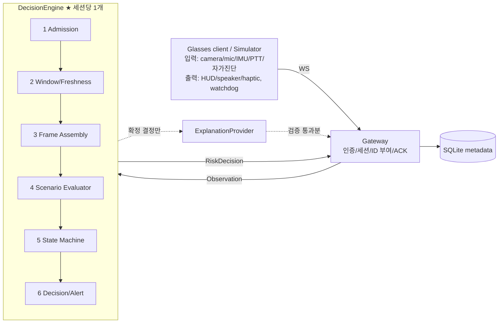

# technical specification - 판단 엔진 중심 v0.5

> **무엇을 만들지**는 `01-product-requirements.md`, **어떻게 만들지**는 이 문서, **모듈과 팀 경계**는 `03-collaboration-architecture.md`, **어떤 순서로 만들지**는 `04-implementation-plan.md`에 있다.
> 이 문서는 **구현에 필요한 결정을 모두 확정한 상태**다. 필드명, 상태, enum, 전이 조건, 계산식은 여기 적힌 그대로 구현한다.
> 이 문서에 없는 값을 지어내지 않는다. 바꿔야 한다면 이 문서를 먼저 고친다.
> 숫자 파라미터 값은 **테스트용 값**이다. 운영용 값은 Stage C에서 데이터로 정한다. 다만 파라미터의 이름, 단위, 의미는 확정이다.

---

## 1. 이름 / 구조 / 도구

| 항목 | 확정값 |
|---|---|
| 배포 이름 | `v-open-agent` |
| import 패키지 | `voa` (`apps/server/src/voa/`) |
| 환경변수 접두사 | `VOA_` |
| Python | ≥ 3.11. 실행 환경은 Docker 이미지 `python:3.11-slim-bookworm` (`docker/server.Dockerfile`) |
| 실행 환경 | `dev` target은 저장소를 `/workspace`로 mount하고 개발 도구를 포함한다. `server` target은 `apps/server/src`, `apps/server/config`만 이미지에 복사하고 Android, 테스트, 개발 도구를 포함하지 않는다. DB는 `voa-data`에 둔다. |
| 빌드 | `hatchling`, `apps/server/pyproject.toml` |
| 런타임 의존성 (Stage A) | `pydantic>=2.6,<3`, `pyyaml>=6` |
| 런타임 의존성 (Stage B 추가) | `fastapi`, `uvicorn` / 테스트용 `httpx` |
| 개발 도구 | `pytest`, `types-PyYAML`(mypy용), `ruff`(line-length 100, `select = ["E","F","I","B","UP"]`), `mypy --strict`(`apps/server/src`, `apps/server/tests`) |
| 검증 명령 | 호스트에서 `scripts/build.sh` 또는 `scripts/dev.sh`, 컨테이너에서 `scripts/check.sh` 실행. 서버 검사는 `apps/server`를 작업 디렉터리로 사용 |

```text
apps/
  server/
    pyproject.toml
    src/voa/
      contracts/   enums.py types.py observation.py decision.py messages.py
      config/      profile_loader.py
      engine/      ports.py profile.py admission.py window.py evaluator.py state_machine.py engine.py
      providers/   base.py mock.py
      simulator/   fixture.py adapter.py outputs.py watchdog.py __main__.py
      replay/      runner.py __main__.py
      explain/     repository.py validator.py template.py actions.py
      storage/     sqlite.py
      server/      settings.py auth.py runtime.py app.py ws.py dispatch.py __main__.py
    config/        profiles/ models/ devices.example.yaml
    tests/         contracts/ engine/ explain/ storage/ server/ integration/ fixtures/profiles/
  android/         app/ protocol/ session/ output/ input-mock/ input-media/ device-adapter/
contracts/
  schemas/         JSON Schema snapshots
  fixtures/        shared JSON fixtures and replay scenarios
docker/server.Dockerfile   scripts/check.sh   docs/
```

---

## 2. 시스템 개요



- **위험 상태는 엔진만 결정한다.** Gateway, Provider, VLM에는 판단 로직이 없다.
- Provider(실모델이든 mock이든)는 **프레임마다 관측 1개**를 낸다. 감지된 객체가 0개여도 관측을 낸다. 이 규칙이 있어야 엔진이 "없음"을 확인할 수 있다(D-03).
- 단일 프로세스로 만든다. 엔진은 동기 순수 로직이고, 서버가 asyncio 루프에서 호출한다.

---

## 3. 데이터 계약 (`voa.contracts`)

### 3.1 공통 규칙
- 모든 모델은 `ConfigDict(extra="forbid", frozen=True)`로 정의한다.
- 시각 필드(`*_utc`)는 tz-aware UTC `datetime`이고, JSON 직렬화는 `Z` 접미사를 붙인 ISO-8601이다.
- 정규화 좌표 `BBox = tuple[float, float, float, float]` (x1, y1, x2, y2)는 `0 ≤ x1 < x2 ≤ 1`, `0 ≤ y1 < y2 ≤ 1`을 만족해야 한다.
- `Score`는 `0.0 ≤ s ≤ 1.0`이다.
- ID는 비어 있지 않은 `str`(최대 128자, `[A-Za-z0-9_.:-]`)이다.
- `frozenset` 필드(`quality_flags`)는 **정렬된 리스트로 직렬화**한다(INV-05 바이트 동일성).
- 공통 제약 타입(`Id`, `Score`, `BBox`, `UtcDatetime`)은 `voa.contracts.types`에 둔다.

### 3.2 enum
```python
SourceKind = Literal[
    "object_detection", "track_state", "sound_event", "asr_transcript", "ocr_text", "health"
]
ClockQuality = Literal["synced", "estimated", "unknown"]
RiskState = Literal["clear", "candidate", "warning", "unknown", "resolved"]
Verdict = Literal["met", "absent", "indeterminate"]
Severity = Literal["notice", "attention"]
TextKind = Literal["approved_template", "validated_explanation"]
DeliveryState = Literal["queued", "sent", "received", "played", "expired", "unknown_delivery"]
TrackQuality = Literal["good", "degraded", "lost"]
MotionClass = Literal["static", "moving", "unknown"]
HealthStatus = Literal["ok", "degraded", "down"]
QualityFlag = Literal[
    "occluded", "camera_motion_uncompensated", "low_light", "frame_dropped", "clock_unreliable"
]
SpeakerRole = Literal["authenticated_user", "untrusted_environment", "unknown"]
```
- 원안의 `imu` kind는 MVP에서 쓰지 않으므로 뺐다. IMU는 Provider 내부에서만 쓰고, 그 결과를 `camera_motion_uncompensated` flag로 표현한다.
- 원안의 `approaching_candidate`는 MVP에서 쓰지 않는다. 단안 카메라로는 "접근"을 판정하지 않는다.

### 3.3 Observation

```python
class ModelRef(BaseModel):
    id: str
    revision: str


class Observation(BaseModel):
    schema_version: Literal["0.1.0"]
    observation_id: str  # Gateway(또는 재생기)가 부여. Provider 출력 ID를 쓰지 않는다
    session_id: str
    device_id: str
    stream_id: str  # 센서 이름: camera_0, mic_0
    seq: int  # >= 0. (session_id, stream_id, source_kind, model_id) 범위에서 단조 증가 (D-04, ADR-0004)
    capture_ts_monotonic_ns: int  # 장치 monotonic. 같은 (stream, kind) 안의 순서 비교에만 사용
    received_at_utc: datetime  # 서버 벽시계. 로그/표시 전용, 판단에는 사용하지 않음
    server_received_mono_ns: int  # 서버 monotonic. 신선도 판정의 유일한 기준
    clock_quality: ClockQuality
    model: ModelRef | None  # 영상 계열은 필수. mock: ModelRef(id="mock-detector", revision="0")
    quality_flags: frozenset[QualityFlag] = frozenset()
    payload: Payload  # Field(discriminator="kind")

    @property
    def source_kind(self) -> SourceKind:
        return self.payload.kind
```

**Payload** — 영상 계열은 **프레임 단위**로 만든다(D-03).

```python
class Detection(BaseModel):
    label: str
    class_id: int | None = None
    bbox: BBox
    score: Score


class DetectionPayload(BaseModel):  # 프레임당 1개. detections 는 빈 리스트일 수 있음
    kind: Literal["object_detection"]
    frame_id: str
    detections: list[Detection]


class Track(BaseModel):
    track_id: str
    label: str
    bbox: BBox
    score: Score
    quality: TrackQuality
    motion_class: MotionClass
    age_frames: int  # >= 1


class TrackPayload(BaseModel):  # 프레임당 1개. tracks 는 빈 리스트일 수 있음
    kind: Literal["track_state"]
    frame_id: str
    tracks: list[Track]


class SoundEventPayload(BaseModel):
    kind: Literal["sound_event"]
    chunk_id: str
    window_start_ns: int
    window_end_ns: int  # start < end
    events: list[tuple[str, Score]]  # (label, score), 빈 리스트 허용


class AsrPayload(BaseModel):
    kind: Literal["asr_transcript"]
    utterance_id: str
    revision: int  # >= 0
    is_final: bool
    text: str  # 최대 500자
    speaker_role: SpeakerRole
    authentication_basis: Literal["explicit_push_to_talk", "none"]


class OcrPayload(BaseModel):
    kind: Literal["ocr_text"]
    frame_id: str
    text: str  # 최대 500자, 비신뢰 데이터
    bbox: BBox
    language: str
    score: Score


class HealthPayload(BaseModel):  # 상태를 보고하는 대상 센서 = Observation.stream_id
    kind: Literal["health"]
    status: HealthStatus
    detail_code: str


class ObservationDraft(BaseModel):  # 장치/시뮬레이터/Provider 가 만드는 형태 (서버 필드 없음)
    stream_id: str
    seq: int
    capture_ts_monotonic_ns: int
    clock_quality: ClockQuality = "unknown"
    model: ModelRef | None = None
    quality_flags: frozenset[QualityFlag] = frozenset()
    payload: Payload
```
**모델 출처 (ADR-0004)**: `payload.kind`가 `object_detection` 또는 `track_state`이면 `model`이 반드시 있어야 한다(`ObservationDraft`와 `Observation` 모두 검증, 없으면 스키마 오류). 다른 kind는 `model`이 없어도 된다. 관측의 **모델 키** `model_id`는 `model.id`이고 `model`이 없으면 빈 문자열 `""`이다. 한 카메라 프레임을 여러 모델이 분석하면 모델마다 같은 `frame_id`로 관측을 하나씩 내고, `seq`는 모델마다 독립적으로 증가한다.

Gateway(또는 재생기)는 Draft에 `schema_version`, `observation_id`, `session_id`, `device_id`, `server_received_mono_ns`, `received_at_utc`를 붙여 `Observation`을 만든다. `clock_quality`는 기록용이며 엔진 판단에는 쓰지 않는다.

`speaker_role="authenticated_user"`는 PTT 같은 입력 채널이 인증됐다는 뜻일 뿐, 음성으로 신원을 인증했다는 뜻이 아니다.

### 3.4 RiskDecision / Alert
```python
class Alert(BaseModel):
    alert_id: str
    text: str
    text_kind: TextKind
    delivery_state: DeliveryState
    valid_until_utc: datetime | None = None  # 이 시각 이후에는 전송/재전송 금지


class RiskDecision(BaseModel):
    schema_version: Literal["0.1.0"]
    risk_event_id: str
    session_id: str
    device_id: str
    scenario_id: str
    policy_version: str  # f"{profile_id}@{profile_version}"
    state: RiskState
    previous_state: RiskState | None = None
    severity: Severity | None = None
    evidence_ids: list[str]
    reason_codes: list[ReasonCode]  # §4.8 의 Literal
    model_versions: dict[str, str] = {}  # 근거 관측들의 model.id -> revision
    decided_at_utc: datetime
    alert: Alert | None = None
    fixture_note: str | None = None  # 합성 fixture 표시용. 엔진은 항상 None을 출력
```

**모델 검증기**
1. `state == "warning"` ⇔ `alert is not None`
2. `state == "warning"` ⇒ `severity is not None` 이고 `len(evidence_ids) ≥ 1`
3. `reason_codes`는 1개 이상
4. `alert is not None` ⇒ `alert.delivery_state == "queued"` — RiskDecision은 **생성 시점의 불변 기록**이다. 이후 전달 상태(`sent`, `received` 등)는 Dispatcher와 `alerts` 테이블(§7.3, §8.1)이 따로 관리하며 RiskDecision을 수정하지 않는다.

`contracts/fixtures/risk_event.json`은 positive fixture다. JSON Schema 스냅샷은 `contracts/schemas/*.json`에 두어 Python과 Android가 공유한다.

---

## 4. 판단 엔진 (`voa.engine`) ★

### 4.0 불변식 (INV) — 각각 전용 테스트로 강제

| ID | 불변식 |
|---|---|
| INV-01 | `warning` 결정의 `evidence_ids`는 1개 이상이고, 모두 결정 시점에 window 인덱스에 존재하며 같은 세션에 속한다 |
| INV-02 | `warning` 결정의 근거 관측은 모두 결정 시점 기준 나이가 `staleness_ms` 이하다 |
| INV-03 | `unknown → warning` 전이는 없다 |
| INV-04 | `→ resolved`와 `candidate → clear`, `unknown → clear`는 오직 `absent` 판정이 `clear_frames`번 연속될 때만 일어난다 |
| INV-05 | 같은 profile에 같은 입력 이벤트 시퀀스(관측, `now_mono_ns`)를 넣으면 같은 결정 시퀀스가 나온다 (JSON 직렬화 결과가 바이트 단위로 같음) |
| INV-06 | `voa.engine`과 `voa.contracts`가 import할 수 있는 것은 표준 라이브러리 `__future__`, `dataclasses`, `typing`, `collections`, `enum`, `math`, `datetime`, `re`와 `pydantic`, 그리고 `voa.engine`/`voa.contracts` 자신뿐이다. 그 밖의 모듈(예: `time`, `random`, `os`, `pathlib`, `yaml`, `asyncio`, `socket`)은 import하지 않는다. 테스트는 이 허용 목록과 AST 상의 import를 대조한다 |
| INV-07 | Admission이 `accepted`로 판정하지 않은 관측은 상태와 카운터를 바꾸지 않는다 |
| INV-08 | `alert.text`는 해당 시나리오의 `warning_text`와 정확히 같고 `text_kind == "approved_template"`이다 |
| INV-09 | 결정은 `state`가 바뀔 때만 나온다. 바로 앞 결정과 같은 state를 연속으로 내지 않는다 |
| INV-10 | profile이 유효하지 않으면(`ProfileError`) 엔진은 모든 관측을 `config_error`로 거부하고 결정을 하나도 내지 않는다. 서버는 `readyz` 503을 반환한다 |

### 4.1 인터페이스

```python
class IdFactory(Protocol):
    def new(self, prefix: Literal["risk", "alert", "obs", "sess", "notice"]) -> str: ...
# 테스트/리플레이: SequentialIdFactory -> "risk_0001", "alert_0001" ...

class UtcClock(Protocol):
    def at(self, mono_ns: int) -> datetime: ...
# 테스트/리플레이: FixedEpochClock(epoch=2026-11-09T00:00:00Z) -> epoch + mono_ns

class DecisionEngine:
    def __init__(self, session_id: str, device_id: str, profile: PolicyProfile | ProfileError,
                 ids: IdFactory, clock: UtcClock) -> None
    def step(self, obs: Observation, now_mono_ns: int) -> StepResult      # 관측 1개 처리
    def tick(self, now_mono_ns: int) -> list[RiskDecision]                # 시간 경과만 반영
    def states(self) -> dict[str, RiskState]                              # scenario_id -> state
    def get_observation(self, observation_id: str) -> Observation | None  # 읽기 전용 근거 조회
    def is_fresh(self, observation_id: str, now_mono_ns: int) -> bool     # 상태 변경 없는 조회

@dataclass(frozen=True)
class StepResult:
    admission: AdmissionStatus
    decisions: list[RiskDecision]
```
- 엔진은 **세션당 1개**다. `now_mono_ns`는 단조 비감소여야 하며, 감소하면 `ValueError`를 던진다(호출자 버그).
- `get_observation()`과 `is_fresh()`는 window 인덱스의 읽기 전용 view다. 카운터, 상태, window 보존 기간을 바꾸지 않는다. 이미 축출된 ID는 각각 `None`, `False`를 반환한다. `now_mono_ns`가 엔진의 마지막 시각보다 과거면 `ValueError`를 던지며 조회는 엔진 시각을 전진시키지 않는다.
- `PolicyProfile`은 이미 파싱/검증된 객체로 받는다. 파일 읽기는 `voa.config.profile_loader`가 하고, 실패하면 `ProfileError`를 넘긴다(INV-06).
- **`step(obs, now)` 처리 순서**: Admission → Window 갱신 → (accepted이면) 시나리오별 Frame Assembly → 이번 호출에서 프레임이 완성된 시나리오는 **전이표 전체(§4.6)** 를 적용하고, 나머지 시나리오는 **시간 규칙(행 1/2/4)만** 적용한다.
- **`tick(now)`**: 모든 시나리오에 시간 규칙(행 1/2/4)만 적용한다. 카운터는 바꾸지 않는다.
- **한 번 호출할 때 시나리오당 전이는 최대 1회**다. 결정은 profile에 정의된 시나리오 순서대로 출력한다.
- 서버는 `VOA_TICK_INTERVAL_MS`마다 `tick()`을 호출한다. 리플레이에서는 fixture의 `tick` 라인이 이 역할을 한다.
- **시작 상태**: 모든 시나리오는 `unknown`이고 `risk_event_id = None`, 카운터는 0이다. 시작 상태에 대한 결정은 출력하지 않는다. 서버를 재시작해도 같다(상태를 복원하지 않음).
- **profile이 무효(`ProfileError`)일 때**: `step()`은 모든 관측에 `AdmissionStatus = "config_error"`를 반환하고 결정을 내지 않는다. 시나리오 목록을 알 수 없으므로 결정 출력도 없다. 이 상태는 서버 `readyz` 503과 status API로 노출한다(INV-10).
- 서버 운영 구현은 `voa.server.runtime` 안의 `SecureIdFactory`와 `AnchoredUtcClock`을 사용한다. `SecureIdFactory` ID는 `secrets.token_urlsafe(18)`을 사용해 `f"{prefix}_{token}"`으로 만들고 서버 프로세스 전체에서 하나의 factory를 공유한다. `AnchoredUtcClock`은 시작 시점의 UTC wall clock과 `time.monotonic_ns()`를 함께 고정하고, `anchor_utc + timedelta(microseconds=(mono_ns - anchor_mono_ns) // 1000)`으로 UTC를 매핑한다. `SequentialIdFactory`와 `FixedEpochClock`은 테스트와 리플레이에만 사용한다.

### 4.2 단계 1 — Admission

순서대로 검사하고, 처음 실패한 항목의 결과를 반환한다.

`AdmissionStatus = Literal["accepted", "rejected_session_mismatch", "duplicate", "out_of_order", "stale_on_arrival", "config_error"]`

| # | 검사 | 결과 `AdmissionStatus` |
|---|---|---|
| 0 | profile 무효 | `config_error` |
| 1 | `session_id`, `device_id`가 엔진과 일치 | `rejected_session_mismatch` |
| 2 | `observation_id`를 이미 받았음 (window 보존 기간 내) | `duplicate` |
| 3 | `seq ≤ last_seq[(stream_id, source_kind, model_id)]` | `out_of_order` |
| 4 | `capture_ts_monotonic_ns < last_capture[(stream_id, source_kind, model_id)]` | `out_of_order` |
| 5 | `now_mono_ns - server_received_mono_ns > staleness_ms × 1e6` (도착했을 때 이미 오래됨) | `stale_on_arrival` |
| — | 통과 | `accepted` |

- 스키마 오류는 엔진에 들어오기 전 Pydantic 파싱 단계에서 거부한다. Gateway는 이를 `rejected_schema`로 응답한다.
- `out_of_order`, `stale_on_arrival`, `duplicate`는 상태에 영향이 없다(INV-07). 카운트만 계측한다.
- 아직 `accepted` 관측이 없는 key는 3/4번 검사를 통과한 것으로 본다.

### 4.3 단계 2 — Window / Freshness
- **Window**: key `(stream_id, source_kind, model_id)`마다 `deque`를 둔다(ADR-0004). 최근 `window_max_items`개만 유지하고, 나이가 `window_ms`를 넘은 항목은 매 호출마다 제거한다. `observation_id → Observation` 인덱스도 함께 유지하고 같이 제거한다.
- **신선도**: 관측 o는 `now_mono_ns - o.server_received_mono_ns ≤ staleness_ms × 1e6`일 때 *fresh*다.
- **센서 상태** `sensor_down[stream_id]`: `health` 관측(`stream_id` = 대상 센서)의 `status == "down"`이면 True, `"ok"`나 `"degraded"`이면 False가 된다. 기본값은 False다.

### 4.4 단계 3 — Frame Assembly (시나리오별)
- 시나리오마다 조립 버퍼(`frame_id` → kind별 관측)를 따로 둔다. `stream_id ∈ required_streams`, `source_kind ∈ required_kinds`, `model_id == required_models[source_kind]`인 accepted 관측만 넣는다. 다른 모델이 같은 `frame_id`로 낸 관측은 이 시나리오의 프레임을 완성하지 못한다(ADR-0004). 따라서 근거 모델이 멈추면 다른 모델이 돌고 있어도 그 시나리오는 행 2(`input_stale`)로 `unknown`이 된다.
- 한 `frame_id`에 `required_kinds`가 **모두** 모이면 그 프레임은 "완성"이고, 그 시나리오에 대해 **딱 한 번** 평가한 뒤 버퍼에서 지운다. 같은 frame_id로 늦게 도착한 관측은 무시한다(완성된 frame_id 집합은 `window_ms` 동안 기억).
- **완성 시점에 신선도를 다시 확인**한다. 프레임 관측 중 하나라도 fresh가 아니면 그 프레임은 평가하지 않고 버린다(INV-02 보장).
- 완성되지 않은 프레임은 평가하지 않는다. 예를 들어 tracker가 멈춰 detection만 들어오면 track 시나리오의 프레임이 완성되지 않고, 결국 행 2(`input_stale`)로 `unknown`이 된다.
- 나이가 `window_ms`를 넘은 미완성 프레임은 버퍼에서 제거한다.

### 4.5 단계 4 — Scenario Evaluator (3값)

입력은 완성된 프레임의 관측들(시나리오의 `required_kinds` 각 1개)이고, 출력은 `ConditionResult(verdict, evidence_ids, reason)`이다.

먼저 대상(candidate object)을 정의한다.
- `required_kinds = [object_detection]`이면 대상은 detection 항목들이다.
- `required_kinds = [object_detection, track_state]`이면 대상은 track 항목들이다. detection 관측은 "detector가 이 프레임을 처리했다"는 신선도 근거로만 쓴다.

대상 o가 **qualifying**이라는 것은 다음을 모두 만족한다는 뜻이다.
`o.label ∈ labels` ∧ `o.score ≥ min_score` ∧ `overlap(o.bbox, roi) ≥ roi_min_overlap` ∧ (track일 때) `o.quality != "lost"` ∧ `o.motion_class ∈ motion_classes`

여기서 `overlap(b, roi) = area(b ∩ roi) / area(b)`로 계산한다(대상 bbox 중 ROI 안에 들어간 비율).

판정 순서는 아래와 같다. 위에서부터 처음 해당하는 결과를 쓴다.

| # | 조건 | verdict | reason |
|---|---|---|---|
| 1 | 프레임 관측 중 하나라도 `blocking_flags`와 교집합이 있음 | indeterminate | `quality_blocked` |
| 2 | 대상 중 `label ∈ labels`이고 `overlap(o.bbox, roi) ≥ roi_min_overlap`이며 `quality == "lost"`인 track이 있고, qualifying 대상은 없음 | indeterminate | `track_lost` |
| 3 | qualifying 대상이 1개 이상 | met | `condition_observed` |
| 4 | 그 외 | absent | `condition_absent` |

- 판정 순서는 `blocking_flags` 검사가 먼저다. 차단 flag가 붙은 프레임에서는 met도 absent도 인정하지 않는다.
- `met`이나 `absent`일 때 `evidence_ids`는 그 프레임에 사용된 관측 ID 전부(시나리오의 required kind 수만큼)다.

### 4.6 단계 5 — State Machine (시나리오별)

**시나리오별 상태 변수**: `state`, `risk_event_id: str | None`, `met_streak: int`, `absent_streak: int`, `last_determinate_mono_ns: int | None`, `last_indeterminate_reason: ReasonCode | None`

**프레임 판정이 들어올 때 카운터 갱신** (전이표 적용 **전에** 수행)
- `met`: `met_streak += 1`, `absent_streak = 0`, `last_determinate = now`, `last_indeterminate_reason = None`
- `absent`: `absent_streak += 1`, `met_streak = 0`, `last_determinate = now`, `last_indeterminate_reason = None`
- `indeterminate`: `met_streak = 0`, `absent_streak = 0`, `last_indeterminate_reason = 판정 reason` (`last_determinate`는 그대로)

**unknown으로 전이할 때마다**(행 1/2) `met_streak = absent_streak = 0`으로 되돌린다. 그래서 unknown을 빠져나가려면 unknown 진입 **이후의** 신선한 판정이 필요하다.

**전이표** — 평가 시점마다 **위에서부터 처음 맞는 행 하나만** 적용한다. 표에 없는 전이는 일어나지 않는다.

| # | 현재 | 조건 | 다음 | reason_codes | risk_event_id |
|---|---|---|---|---|---|
| 1 | unknown 제외 | `required_streams` 중 하나라도 `sensor_down` | unknown | `[sensor_down]` | 유지 (현재가 resolved면 종료) |
| 2 | unknown 제외 | `now - last_determinate > unknown_after_ms × 1e6` | unknown | `[input_stale]` + (`last_indeterminate_reason`이 있으면 추가) | 유지 (현재가 resolved면 종료) |
| 3 | resolved | 프레임 평가이고 `met_streak ≥ 1` | candidate | `[condition_observed]` | **새로 발급** |
| 4 | resolved | (행 3에 해당하지 않음) | clear | `[episode_closed]` | **종료** |
| 5 | clear | `met_streak ≥ 1` | candidate | `[condition_observed]` | **새로 발급** |
| 6 | candidate | `met_streak ≥ confirm_frames` | warning | `[temporal_confirmation_passed]` | 유지 |
| 7 | candidate | `absent_streak ≥ clear_frames` | clear | `[condition_absent_confirmed]` | **종료** |
| 8 | warning | `absent_streak ≥ clear_frames` | resolved | `[condition_absent_confirmed]` | 유지 |
| 9 | unknown | `met_streak ≥ 1` 이고 `required_streams` 중 down인 것이 없음 | candidate | `[fresh_evidence_returned]` | 있으면 유지, 없으면 **새로 발급** |
| 10 | unknown | `absent_streak ≥ clear_frames` 이고 `required_streams` 중 down인 것이 없음 | clear | `[condition_absent_confirmed]` | **종료** |

- **시간 규칙 = 행 1/2/4.** `tick()`과, 이번 호출에서 프레임이 완성되지 않은 시나리오에는 이 세 행만 검사한다. 나머지 행은 프레임 평가에서만 적용한다.
- **resolved는 다음 평가 시점에 반드시 빠져나간다.** 새 met이면 행 3, 아니면 행 4로 간다. 같은 호출 안에서는 warning→resolved→clear처럼 두 번 전이하지 않는다.
- 행 2의 시간 비교는 unknown이 아닌 상태에서만 한다. unknown을 떠나려면 신선한 판정이 필요하므로, 이때 `last_determinate`는 항상 값이 있다.
- **warning에는 별도의 TTL 전이가 없다.** 입력이 끊기면 행 2로 unknown이 된다. `warning_ttl_ms`는 alert의 `valid_until_utc` 계산에만 쓴다.
- **profile은 엔진을 만들 때 고정된다.** 런타임에 교체하는 기능은 MVP 범위가 아니다. profile을 바꾸려면 세션을 새로 시작한다.
- **warning에서 met이 계속 들어오면** 상태를 유지하고 결정을 내지 않는다(INV-09).
- "종료"는 전이 후 `risk_event_id = None`이라는 뜻이다. 결정에는 종료 직전 값을 기록한다(§4.7).

### 4.7 단계 6 — Decision / Alert
- 전이가 일어날 때마다 `RiskDecision`을 하나 만든다.
  - `risk_event_id`: 전이 후 값. 종료되는 전이라면 종료 직전 값을 쓴다. 어느 쪽도 없으면(예: 시작 unknown → clear) 문자열 `"none"`이다.
  - `evidence_ids`: 이번 평가에서 쓴 프레임의 관측 ID. tick에서 일어난 전이라면 빈 리스트다.
  - `model_versions`: 근거 관측들의 `model`을 모은 것이다.
  - `decided_at_utc = clock.at(now_mono_ns)`
- `warning`으로 전이할 때마다(행 6) `Alert`를 새로 만든다.
  `alert_id = ids.new("alert")`, `text = scenario.warning_text`, `text_kind = "approved_template"`, `delivery_state = "queued"`, `valid_until_utc = decided_at + warning_ttl_ms`
- **중복 방지 기준은 `alert_id`다.** 같은 episode라도 unknown을 거쳐 다시 warning이 되면 새 alert를 만든다. 센서가 복구된 뒤 위험을 다시 알리는 것은 의도된 동작이다.

### 4.8 reason_code (확정 목록)
```python
ReasonCode = Literal[
    "condition_observed",
    "temporal_confirmation_passed",
    "condition_absent_confirmed",
    "episode_closed",
    "input_stale",
    "quality_blocked",
    "track_lost",
    "sensor_down",
    "fresh_evidence_returned",
]
```
`quality_blocked`와 `track_lost`는 프레임 판정 reason이다. 이 판정이 계속되어 행 2로 unknown이 되면 결정의 `reason_codes`는 `["input_stale", "quality_blocked"]`처럼 된다. `condition_absent`는 프레임 판정 reason일 뿐 결정에는 나오지 않으므로 `ReasonCode`에 넣지 않는다(evaluator 내부 Literal).

### 4.9 Policy Profile

```yaml
profile_id: indoor_research_v0
profile_version: 1
degraded_notice_text: "카메라 상태를 확인할 수 없어 감지가 제한됩니다."
params:                       # 단위는 이름의 접미사를 따른다. 값은 테스트용
  min_score: 0.5              # 0..1
  roi_min_overlap: 0.3        # 0..1
  confirm_frames: 3           # >= 1
  clear_frames: 3             # >= 1
  staleness_ms: 1000          # > 0
  unknown_after_ms: 1500      # >= staleness_ms
  warning_ttl_ms: 4000        # > 0
  window_ms: 5000             # >= unknown_after_ms
  window_max_items: 256       # >= 1
scenarios:
  - id: moving_object_in_attention_zone
    required_kinds: [object_detection, track_state]
    required_models: {object_detection: mock-detector, track_state: mock-tracker}
    required_streams: [camera_0]
    labels: [person]
    motion_classes: [moving]
    roi: [0.25, 0.30, 0.75, 1.00]
    blocking_flags: [occluded, camera_motion_uncompensated, frame_dropped]
    warning_text: "전방 이동 물체에 주의하세요."
    severity: attention
  - id: visible_obstacle_in_corridor
    required_kinds: [object_detection]
    required_models: {object_detection: mock-detector}
    required_streams: [camera_0]
    labels: [obstacle]
    motion_classes: []        # detection 시나리오는 반드시 빈 리스트, track 시나리오는 1개 이상
    roi: [0.20, 0.40, 0.80, 1.00]
    blocking_flags: [occluded, frame_dropped]
    warning_text: "전방 통로에 장애물이 보입니다."
    severity: attention
```

**검증** — `voa.engine.profile.PolicyProfile`(Pydantic)이 수행하고, 실패하면 로더가 `ProfileError(code, detail)`로 감싼다.
- 필수 키 누락, 알 수 없는 키, 시나리오 ID 중복
- `required_kinds`가 `[object_detection]`이나 `[object_detection, track_state]` 둘 중 하나가 아님
- `motion_classes` 규칙 위반, 위 범위 조건 위반
- `warning_text`나 `degraded_notice_text`가 비어 있거나, `roi`가 BBox 규칙 위반
- 시나리오가 1개도 없음
- `required_models`의 key 집합이 `required_kinds`와 다름, 값이 ID 규칙 위반 (ADR-0004)

**모델 manifest 대조** (ADR-0004, CON-04) — `voa.config`가 수행한다(엔진은 파일을 읽지 않음). `voa.config.model_registry.load_manifests(dir)`가 `apps/server/config/models/*.yaml`을 읽고, `check_profile_models(profile, manifests) -> ProfileError | None`가 시나리오마다 다음을 확인한다. 위반은 `ProfileError("profile_invalid", detail)`이며 detail에는 시나리오 ID와 위반 항목 이름만 담는다.
- `required_models`의 모든 모델 ID에 manifest가 있음
- manifest의 `kind`가 그 key(`source_kind`)와 같음
- 시나리오 `labels`가 `object_detection` 근거 모델 manifest의 `labels` 안에 있음. track 시나리오는 `track_state` 근거 모델의 `labels`에도 있어야 함

`ProfileErrorCode = Literal["file_not_found", "yaml_invalid", "profile_invalid"]`이다. `detail`은 파일 경로와 검증 위치만 담고 YAML 원문, secret, token을 담지 않는다. YAML root가 mapping이 아니거나 YAML 파싱이 실패하면 `yaml_invalid`, Pydantic 검증 실패는 `profile_invalid`이다.

- MVP의 시나리오 kind 조합은 이 두 가지뿐이다. 오디오 시나리오는 Stage D에서 이 문서를 확장할 때 추가한다.
- `camera_motion_uncompensated`는 tracker(또는 IMU를 쓰는 provider)가 보정에 실패했을 때 붙이는 flag다. 장치에 IMU가 없으면 이동 물체 시나리오는 항상 `unknown`이 된다. 이는 의도된 동작이다(T-R15).

---

## 5. Fixture / 시뮬레이터 / 리플레이

**시나리오 fixture** `contracts/fixtures/scenarios/<name>.jsonl` — 한 줄에 이벤트 하나:
```json
{"at_ms": 0,    "obs": {"stream_id": "camera_0", "seq": 0, "capture_ts_monotonic_ns": 0, "quality_flags": [], "payload": {"kind": "object_detection", "frame_id": "f0", "detections": [{"label": "obstacle", "bbox": [0.3,0.5,0.6,0.9], "score": 0.9}]}}}
{"at_ms": 2000, "tick": true}
```
- 재생기는 다음 필드를 채운다.
  - `observation_id = f"obs_{n:04d}"` (n은 0부터 시작하는 관측 순번)
  - `session_id = "sess_fixture"`, `device_id = "dev_fixture"`, `schema_version`
  - `server_received_mono_ns = at_ms × 1e6`, `received_at_utc = clock.at(server_received_mono_ns)`
  - `clock_quality`, `model`, `quality_flags`는 fixture에 있으면 그 값을 쓰고, 없으면 Draft 기본값을 쓴다
- `now_mono_ns = at_ms × 1e6`이다. `at_ms`는 비감소여야 한다.

**기대 결과** `<name>.expected.jsonl` — 결정 하나에 한 줄. 비교 필드: `scenario_id, previous_state, state, reason_codes, evidence_ids, risk_event_id, alert_id(있으면)`

- **리플레이 CLI**: `python -m voa.replay <fixture.jsonl> [--profile path] [--expected path]`
  - 결정을 JSONL로 출력한다.
  - `--expected`가 있으면 첫 번째 불일치 위치(줄 번호와 필드)를 출력하고 exit 1로 끝난다.
  - 마지막에 `step` 처리 시간의 p50/p95(µs)를 stderr로 출력한다. 측정용이며 결정 결과에는 포함하지 않는다.
- `voa.providers.base.ObservationProvider` Protocol: `def process(self, item: object) -> list[ObservationDraft]` (Draft = 서버 필드가 없는 관측)
- `MockVisionProvider`: fixture 스크립트(프레임마다 객체 목록)로 detection과 track Draft를 만든다.

---

## 6. 설명 / 근거 검증 / 행동 (`voa.explain`)

- `ObservationRepository(engine)`: `get(observation_id) -> Observation | None`, `is_fresh(id, now)`, `session_of(id)`. 구현은 `DecisionEngine.get_observation()`과 `DecisionEngine.is_fresh()` 공개 조회만 사용하고 engine/window의 private 필드를 읽지 않는다. `session_of(id)`는 `get()`으로 조회한 `Observation.session_id`를 반환하며 없으면 `None`이다.
- `ExplanationValidator.validate(text, evidence_ids, session_id, now) -> ValidationResult(ok, violations[])`가 잡아내는 위반:

| 코드 | 규칙 |
|---|---|
| `unknown_evidence` | repository에 없는 ID |
| `foreign_session` | 다른 세션의 ID |
| `stale_evidence` | 나이가 `staleness_ms`를 넘은 근거 |
| `numeric_claim` | 정규식 `\d+(?:[.,]\d+)?\s*(?:m|cm|mm|km|km/h|㎞|미터|센티|킬로|%|퍼센트|초|분)` (대소문자 무시) 일치 |
| `identity_claim` | 부분 문자열 일치: `IDENTITY_TERMS = ("신원", "이름은", "사번", "직원번호", "얼굴 인식", "누구인지")` |
| `action_claim` | 부분 문자열 일치: `ACTION_TERMS = ("신고했", "신고 완료", "정지시켰", "멈췄", "차단했", "전송했", "호출했")` |

금칙어는 `voa.explain.validator` 모듈 상수로 둔다. 목록을 바꾸면 테스트도 함께 고친다.

- 위반이 하나라도 있으면 `TemplateExplanationProvider`가 시나리오의 `warning_text`를 반환한다(`text_kind="approved_template"`).
- `ActionExecutor.execute(action_kind, ...)`:
  - 허용 목록: `play_alert`, `show_text`, `repeat_last_verified_alert`, `acknowledge_alert`, `export_metadata_if_authorized`
  - 허용 목록에 없는 이름이 오면 `ForbiddenActionError`를 던진다.
  - `idempotency_key = sha256("|".join([device_id, scenario_id, risk_event_id, alert_id, action_kind]))`
- 비신뢰 텍스트(OCR, `speaker_role != authenticated_user`인 ASR, VLM 출력)는 행동 트리거로 들어오지 못한다. 행동은 `is_final=True` ∧ `authenticated_user` ∧ `explicit_push_to_talk`인 ASR로만 트리거하고, 허용 목록 중 읽기 전용 2개(`repeat_last_verified_alert`, `acknowledge_alert`)에만 연결한다(Stage D).

---

## 7. 서버 / 전송 (`voa.server`)

### 7.1 장치 등록과 인증

**계정 (ADR-0011)**: 사람 계정은 관리자와 착용자 두 종류다.
- 관리자 `admin`의 초기 비밀번호는 `admin`이다. 초기값 상태에서는 `127.0.0.1` 접속에서만 로그인되고, 비밀번호를 바꾸기 전까지 관리자 API는 403 `password_change_required`다. `VOA_BIND`가 루프백이 아닌데 초기값이면 서버는 시작하지 않는다.
- `POST /v1/auth/login {username, password}` → `{token, token_expires_at_utc, role, password_change_required}`. `POST /v1/auth/password {current_password, new_password}`(Bearer)로 비밀번호를 바꾼다.
- 착용자 가입: `POST /v1/auth/signup {username, password, display_name?}` → 201 `{user_id, status}`.
  - `username`은 `^[a-z0-9_-]{3,32}$`이고, 중복이면 409 `username_taken`이다.
  - 비밀번호는 8자 이상이고 `username`과 같을 수 없다.
  - 기본 상태는 `pending`이고 관리자가 승인하면 `active`다(`VOA_SIGNUP_REQUIRES_APPROVAL`). `VOA_SIGNUP_ENABLED=false`면 403 `signup_disabled`다.
- 착용자 세션: `POST /v1/sessions {username, password, device_label?, capabilities, mission_id?}`. 세션에 `user_id`가 붙는다.
  - 인증 실패(비밀번호 오류, 없는 계정, `disabled`)는 같은 비용의 scrypt를 거쳐 원인 구분 없이 401이다.
  - 비밀번호가 맞고 `pending`이면 403 `account_pending`이다.
  - 같은 `username`으로 5분 안에 5회 실패하면 5분 동안 429 `too_many_attempts`다.
- 비밀번호 저장은 아래 장치 secret과 같은 scrypt 규칙이다. 평문은 저장하지 않고 로그에 남기지 않는다.
- 사람이 없는 장치와 테스트는 아래 장치 credential 방식을 계속 쓸 수 있다. 세션 생성은 `{username, password}` 또는 `{device_id, secret}` 중 하나로 인증한다.

- 장치는 `apps/server/config/devices.yaml`(git에서 제외. 형식은 같은 폴더의 `devices.example.yaml`)에 다음 형태로 등록한다. 알 수 없는 키는 거부한다.
```yaml
devices:
  - device_id: dev_example
    secret_scrypt:
      salt_hex: "32 lowercase hex chars"
      digest_hex: "64 lowercase hex chars"
    allowed_inputs: [camera_0]
    allowed_outputs: [hud, speaker]
```
- `salt_hex`는 16바이트, `digest_hex`는 32바이트다. 검증값은 `hashlib.scrypt(secret.encode("utf-8"), salt=bytes.fromhex(salt_hex), n=2**14, r=8, p=1, dklen=32)`로 계산하고 `hmac.compare_digest`로 비교한다. 파라미터는 파일에서 바꾸지 않는다.
- `POST /v1/sessions {device_id, secret, capabilities: {inputs: [...], outputs: [...], hud?: {...}}, mission_id?}` → `{session_id, token, token_expires_at_utc, refresh_token, refresh_token_expires_at_utc, heartbeat_ms, watchdog_ms, frame_interval_ms, mission: {mission_id, version, name} | null}` (`frame_interval_ms`는 §7.6, 미션은 ADR-0010. `mission_id`를 생략하면 `VOA_DEFAULT_MISSION`, 그것도 비어 있으면 미션 없이 만들고 장치가 고른다)
  - **동시 세션 상한 (ADR-0010)**: 장치 세션 수가 `VOA_MAX_SESSIONS`에 이르면 503 `{"code":"capacity_exceeded","active","max","retry_after_s"}`와 `Retry-After` 헤더를 돌려준다. 관리자 접속은 세지 않는다.
- **미션 선택 (ADR-0010)**: 세션 access token으로 호출한다.
  - `GET /v1/missions` → 게시된 미션 목록 `[{mission_id, name, description, version, scenarios: [{id, labels, severity}], models: [model_id], frame_interval_ms}]`
  - `PUT /v1/sessions/{session_id}/mission {mission_id}` → `{mission_id, version, name, frame_interval_ms}`
    - 고른 미션의 최신 게시 버전으로 세션 엔진을 새로 만든다. 다른 미션으로 바꾸면 이전 엔진을 버리고 새 미션의 시나리오는 모두 `unknown`에서 시작한다.
    - 없거나 게시되지 않은 미션은 404 `mission_not_found`다.
    - 제어 WebSocket에 `mission` 메시지를 보낸다.
  - token과 refresh token은 각각 `secrets.token_urlsafe(32)`로 만든다. 서버는 각 token의 SHA-256 digest만 메모리에 보관하고 검증 시 `hmac.compare_digest`를 사용한다. 평문, secret, digest를 DB와 로그에 남기지 않는다.
  - access token TTL은 `VOA_TOKEN_TTL_S`, refresh token TTL은 `VOA_REFRESH_TOKEN_TTL_S`다. access token은 WebSocket handshake 시점에 검증하며 이미 인증된 WebSocket은 token 만료로 즉시 종료하지 않는다.
  - `POST /v1/sessions/{session_id}/refresh {refresh_token}`은 세션이 서버 메모리에 있고 refresh token이 유효할 때 `{token, token_expires_at_utc, refresh_token, refresh_token_expires_at_utc}`를 반환한다. 성공 시 이전 token 둘을 즉시 폐기하는 일회성 회전이고, 새 refresh token의 만료 시각은 이 시점부터 다시 계산한다(ADR-0005).
  - REST `refresh`(token 회전)와 WebSocket `alert_sync(last_alert_seq)`(놓친 경고 동기화)는 다른 동작이다. 재접속 순서는 `refresh` → WebSocket 핸드셰이크 인증(§7.2) → `alert_sync`이다(ADR-0006, ADR-0009).
  - 서버 프로세스가 재시작하면 token과 세션 엔진을 복원하지 않는다. refresh 요청은 401이고 클라이언트는 장치 credential로 새 세션을 만든다.
  - 인증에 실패하면 401이고, 응답 본문에 원인을 구분하지 않는다.
  - 인증은 통과했지만 `capabilities`가 등록된 `allowed_*`를 벗어나면 400 `capability_not_allowed`다.
  - `outputs`가 비어 있으면 400 `no_output_capability`다. 경고를 출력할 수 없는 장치에는 세션을 열지 않는다.
  - **세션 정리 (ADR-0005)**: WebSocket 연결이 없고 refresh token이 만료된 세션은 정리한다. tick 루프를 멈추고 엔진과 token digest를 메모리에서 지우며 `sessions.ended_at_utc`를 기록한다. 정리된 세션의 refresh와 WebSocket 핸드셰이크는 401이다. 연결 중인 세션은 refresh token이 만료돼도 연결이 끝날 때까지 유지하고, 연결이 끊긴 뒤 다음 정리 검사에서 정리한다. 정리 검사는 `VOA_SESSION_SWEEP_INTERVAL_S`마다 한다.
  - `required_streams`가 `inputs`에 없는 시나리오는 그 세션 동안 계속 `unknown`이다. 이를 위해 서버는 세션을 시작할 때, 선언되지 않은 각 stream에 대해 `health(status="down", detail_code="not_declared")` 관측을 엔진에 먼저 넣는다. 엔진 API는 추가하지 않는다.
- **TLS (ADR-0009)**: `VOA_BIND`가 `127.0.0.1`이 아니면 `VOA_TLS_CERT`, `VOA_TLS_KEY`가 필수이고 모든 REST는 https, WebSocket은 wss다. 없으면 서버는 시작하지 않는다.
- `VOA_ALLOW_INSECURE_DEV=true`는 bind 주소가 `127.0.0.1`일 때만 허용한다. 이때 장치 `dev_fixture`는 secret 없이 세션을 만들 수 있다.
- `POST /v1/sessions`와 refresh endpoint를 제외한 세션 범위 REST API는 `Authorization: Bearer <access token>`을 요구한다. token은 URL, query, 로그에 넣지 않는다. 해당 token의 session과 path의 session이 다르면 404 `not_found`로 응답한다.
- REST 오류 본문은 `{"code": "<stable_code>"}`다. 인증 실패는 원인과 관계없이 401 `{"code":"unauthorized"}`, capability 범위 위반은 400 `capability_not_allowed`, 빈 outputs는 400 `no_output_capability`다. 요청 원문과 secret은 응답에 넣지 않는다.
- 요청 본문이 스키마에 맞지 않으면 400 `invalid_request`다(프레임워크 기본 422는 입력을 되돌려주므로 쓰지 않는다). 서버가 준비되지 않았으면(`readyz` 실패) 세션 발급은 503 `not_ready`다.
- 미등록 장치도 같은 비용의 scrypt 계산을 거쳐 401을 반환한다(응답 시간으로 등록 여부를 구분할 수 없게 한다). insecure dev의 `dev_fixture`는 모든 capability를 허용한다.

### 7.2 WS `/v1/streams/{session_id}` 메시지 (`voa.contracts.messages`)

**연결과 인증 (ADR-0009)**: WebSocket은 핸드셰이크(HTTP upgrade) 단계에서 access token으로 인증한다. 인증에 실패하면 WebSocket을 열지 않고 HTTP 401로 거절한다(연결 후 `auth` 메시지 방식은 폐지).
- 헤더를 붙일 수 있는 클라이언트(글래스 앱): `Authorization: Bearer <access token>`
- 브라우저: `Sec-WebSocket-Protocol: voa.v1, voa.bearer.<access token>`. 서버는 선택한 subprotocol로 `voa.v1`만 되돌려 준다.
- token의 session과 path의 `session_id`가 다르면 401이다. token은 URL과 query에 넣지 않는다.
- 연결이 열리면 서버가 먼저 `auth_ok`를 보낸다. 클라이언트는 그다음 `alert_sync`를 보낸다.
- **정원 초과 (ADR-0010)**: 열린 제어 WebSocket 수가 `VOA_MAX_SESSIONS`를 넘게 되면, 서버는 연결을 받은 뒤 `error(code="capacity_exceeded", active, max, retry_after_s)`를 보내고 close 4503으로 닫는다. 브라우저는 거절된 핸드셰이크의 본문을 읽을 수 없어서, 안내를 메시지로 전달하기 위해 이렇게 한다. 장치는 §7.4 상태 표시줄의 "정원 초과"와 내장 문구로 안내한다.
- **프레임 전송 시작 조건 (ADR-0010)**: 장치는 `auth_ok`와 미션 확정(`mission` 메시지 또는 선택 응답)을 모두 받은 뒤에 §7.6 업로드를 시작한다. 연결이 끊기면 업로드를 멈추고 재접속한 뒤 다시 시작한다.

**프레임은 이 WebSocket으로 보내지 않는다.** 이미지는 §7.6 HTTP 업로드로 보낸다. 이 연결은 경고, ACK, heartbeat처럼 작은 제어 메시지 전용이라, 큰 프레임 때문에 경고가 늦어지지 않는다.

모든 메시지는 `{"type": ..., ...}` JSON 텍스트 프레임이다.
모든 message 모델은 `extra="forbid"`, `frozen=True`이고 `type`을 discriminator로 사용한다. 예를 들어 observation은 `{"type":"observation","observation":{...ObservationDraft...}}`, decision은 `{"type":"decision","decision":{...RiskDecision...}}`처럼 payload를 명시된 키 아래에 둔다.

| 방향 | type | 필드 |
|---|---|---|
| C→S | `alert_sync` | `last_alert_seq` (연결 후 처음 한 번. 이 번호 이후 alert 중 §7.3 조건을 만족하는 것만 다시 받는다. token 회전은 §7.1 REST `refresh`) |
| C→S | `observation` | ObservationDraft (서버가 `observation_id`, `server_received_*`, `received_at_utc`를 채운다) |
| C→S | `ack` | `alert_id`, `status: received\|played` |
| S→C | `auth_ok` | `session_id`, `server_time_utc` |
| S→C | `admission` | `seq`, `stream_id`, `status` (accepted 외의 결과만 보낸다) |
| S→C | `decision` | `decision`: RiskDecision 전체 (상태 표시용) |
| S→C | `alert` | `alert_seq`(세션 내 1부터 증가), Alert, `risk_event_id`, `scenario_id`, `presentation`(§7.4 HUD 표시 규칙, ADR-0009) |
| S→C | `notice` | `notice_id`, `kind: degraded`, `scenario_id`, `text`, `presentation` (§7.4 판단 불가 고지와 HUD 표시 규칙) |
| S→C | `heartbeat` | `server_time_utc`, `states: {scenario_id: RiskState}`, `frames: {received, processed, skipped, rejected}` (`VOA_HEARTBEAT_MS`마다) |
| S→C | `config` | `frame_interval_ms` (관리자 변경, 또는 부하로 서버가 간격을 늘리거나 되돌릴 때 진행 중인 세션에 즉시 보냄. 전송 속도 설정이며 판단 규칙이 아님) |
| S→C | `mission` | `mission_id`, `version`, `name`, `frame_interval_ms` (세션의 미션이 정해지거나 바뀔 때, ADR-0010) |
| S→C | `frame_result` | §7.6 업로드 응답과 같은 본문. 업로드가 `202 accepted`였던 프레임의 결과 |
| S→C | `error` | `code`, `message` (원문 입력을 되돌려 보내지 않음). `capacity_exceeded`는 `active`, `max`, `retry_after_s`를 더 담는다 |

- `alert_sync.last_alert_seq`는 0 이상이다. 아직 alert를 받지 않은 클라이언트(처음 연결)는 0을 보낸다.
- 알 수 없는 type은 `error(code="unsupported_message_type")`, 알려진 type의 schema 오류는 `error(code="rejected_schema")`를 보내고 무시한다.
- 세션에서 선언하지 않은 `stream_id`의 `observation`(health 포함)은 `error(code="stream_not_declared")`를 보내고 무시한다. 그렇지 않으면 미선언 센서에 health `ok`를 보내 주입된 `not_declared` down 상태를 풀 수 있다(DEV-01, T-R17).
- `error.message`는 code마다 고정된 문구이고 클라이언트 입력을 담지 않는다.
- `alert_sync`를 두 번 보내면 protocol 위반이며 `error(code="protocol_error")`를 보내고 무시한다. 폐지된 `auth` 메시지는 `unsupported_message_type`이다.
- JSON 텍스트가 아닌 WebSocket frame은 MVP에서 `unsupported_message_type`으로 무시한다.

**예약 메시지 (미구현, 해당 Stage에서 이 표를 확정)**: C→S `audio_chunk`(PCM), `imu`(센서 배치), `ptt_start`/`ptt_end`(버튼). 서버는 이 메시지가 오면 `error: unsupported_message_type`을 반환하고 무시한다. 카메라 이미지는 WebSocket 메시지가 아니라 §7.6 HTTP 업로드다(ADR-0009).
- S→C `analysis` (Stage E 예약, ADR-0009): `analysis_id`, `risk_event_id`, `scenario_id`, `claims[{text, evidence_ids}]`, `reviewers[]`, `status`. 확정된 결정만 입력으로 받는 분석기(VLM, 여러 서브에이전트 검토와 종합)의 결과를 끝나는 대로 보낸다. 경고를 만들거나 막거나 바꾸지 않고, claim은 §6 validator를 통과한 것만 보낸다.

### 7.3 전달 / ACK / 재접속
- **alert 전달 상태**: 생성 시 `queued` → WS로 보내면 `sent` → ACK를 받으면 `received` 또는 `played`(played는 received를 포함한다).
- `valid_until_utc`가 지날 때 상태가 `queued`면 `expired`, `sent`면 `unknown_delivery`로 바꿘다. `received`는 수신 확인 증거가 있으므로 기한 경과로 바꾸지 않고 `played` ACK를 기다린다. `played`는 정상 종료 상태다.
- **경고 동기화(`alert_sync`)**: `last_alert_seq`보다 큰 alert 중 다음 세 조건을 모두 만족하는 것만 같은 `alert_id`와 `alert_seq`로 다시 보낸다.
  ① 현재 해당 시나리오 상태가 `warning` ② 그 alert가 현재 episode의 마지막 alert ③ `valid_until_utc`가 아직 지나지 않음
  나머지는 보내지 않는다.
- **중복 ACK**: 같은 `alert_id`와 같은 status의 ACK가 다시 오면 무시한다(멱등). 정상 상태 순서는 `queued < sent < received < played`이고 역행하지 않는다. `unknown_delivery`나 `expired`에서 늦은 `received` 또는 `played` ACK가 오면 해당 ACK 상태로 변경하고 허용 로그 키로 `event="late_ack"`, `alert_id`, `status`를 기록한다. `received`에서 늦은 `played`는 `played`로 올린다. `played`에서 다른 ACK는 무시한다.
- **ACK 경로**: WebSocket `ack` 또는 REST `POST /v1/alerts/{alert_id}/ack {"status": "received"|"played"}`(Bearer access token). REST 성공은 200 `{"alert_id", "delivery_state"}`, token이 없거나 무효면 401 `unauthorized`, 다른 세션의 alert이거나 없는 alert면 404 `not_found`다. WebSocket으로 없는 `alert_id`의 ACK가 오면 응답 없이 무시한다.
- `sent`는 alert 메시지를 실제로 socket에 쓴 뒤에 기록한다. 연결이 없어 보내지 못한 alert는 `queued`로 남는다. 상태가 바뀔 때마다 `alerts` 테이블에 기록한다.
- `notice`는 연결이 없으면 보내지 않고 저장하지 않는다(재전송 대상은 alert뿐이다).
- 장치에 실제로 재생할지는 장치가 `alert_id`로 판단한다. 같은 `alert_id`는 한 번만 재생하는 것이 장치 측 계약이고, 시뮬레이터가 이를 구현해 테스트한다.

### 7.4 글래스 클라이언트 입/출력 계약

글래스(실기기 앱 또는 시뮬레이터)는 **입력 수집 → 전송**과 **경고 렌더링 → ACK**, 그리고 **연결 감시**를 담당한다. 위험 판단은 하지 않는다.

**capability enum**
```python
InputCap = Literal["camera_0", "mic_0", "imu_0", "ptt_0"]
OutputCap = Literal["hud", "speaker", "haptic"]
```

**입력 채널** — 단계별로 무엇을 보내는가

| 입력 | 장치가 보내는 것 | 서버 쪽 처리 | 단계 |
|---|---|---|---|
| `camera_0` | MVP: 프레임마다 `observation`(Draft: detection/track. 시뮬레이터의 mock이 생성) | 그대로 엔진에 투입 | MVP-1 |
| `camera_0` | 프레임 업로드(§7.6, JPEG, 긴 변 ≤ 640px, `frame_id`/`capture_ts` 포함, `frame_interval_ms` 간격, 진행 중 1개) | 서버 Provider(배치된 모델)가 Draft 생성 후 엔진 `step`. 이미지는 처리 중에만 메모리에 두고 저장하지 않음 | Stage C2 (ADR-0009) |
| `imu_0` | `imu` 배치 | tracker가 카메라 움직임 보정에 사용하고, 실패하면 `camera_motion_uncompensated` flag | Stage C |
| `mic_0` | `audio_chunk` (PCM16, 16kHz, mono) | SED/ASR Provider | Stage D |
| `ptt_0` | `ptt_start` / `ptt_end` | 이 구간의 `mic_0` 오디오만 사용자 명령 ASR로 처리 | Stage D |
| (자가 진단) | `observation`(Draft: `health`, `stream_id` = 대상 센서) — 카메라/마이크가 꺼지거나 오류일 때 `down`, 복구되면 `ok` | 엔진의 `sensor_down` | MVP-1 |

**출력 렌더링** — 장치는 `alert`와 `notice`를 선언한 모든 출력으로 내보낸다.

| 출력 | alert | notice (degraded) |
|---|---|---|
| `hud` | `text` 표시. 다음 alert가 오거나 `valid_until_utc`가 될 때까지 유지 | 상태 표시줄에 "감지 제한" 표시. 다음 heartbeat에서 해당 시나리오가 unknown이 아니면 해제 |
| `speaker` | 장치 내장 TTS로 `text`를 읽음. TTS가 없으면 고정 경고음 | `text`를 1회 읽음 |
| `haptic` | 진동 패턴 A (장치 정의) | 진동 패턴 B |

- Stage C0(ADR-0007)에서는 예외로 시뮬레이터가 로컬 프레임 폴더를 읽어 장치 쪽에서 detector Provider를 실행하고 기존 `observation` 메시지로 보낸다. 이 경로는 오프라인 평가와 회귀 테스트용으로 남는다. 제품 경로는 §7.6 프레임 업로드와 서버 추론이다(ADR-0009).

**HUD 표시 규칙 (ADR-0009 결정 5)**: 글래스 앱과 시뮬 페이지는 `alert`/`notice`의 `presentation`을 같은 규칙으로 그린다. 장치마다 표시 방식을 따로 정하지 않는다.

| 필드 | 값 | 규칙 |
|---|---|---|
| `style_id` | 문자열 | 관리자 설정 `hud_styles`의 ID |
| `text` | 승인된 템플릿 문구 | `alert.text`/`notice.text`와 같다. 최대 `max_lines`줄, 넘으면 말줄임 |
| `position` | `top_center` \| `center` \| `bottom_center` | 글래스 표시 영역 기준(안전 여백 5%) |
| `text_size` | `normal` \| `large` | 장치가 정한 두 단계 글자 크기 |
| `color` | `red` \| `yellow` \| `white` | 단색 HUD는 무시하고 반전 강조로 대신 |
| `flash` | `{mode: none\|border\|full_screen, count, on_ms, off_ms}` | 지원하지 않는 mode는 `full_screen` → `border` → `none` 순서로 낮춘다 |
| `show_ms` | 정수 | HUD 유지 시간. 다음 alert나 `valid_until_utc`가 먼저 오면 그때 지운다 |
| `speech` | bool | `speaker` 출력이 있으면 `text`를 TTS로 읽는다 |
| `haptic` | `none` \| `pattern_a` \| `pattern_b` | `haptic` 출력이 있을 때만 |

- 장치는 세션 생성 시 `capabilities.hud: {color: bool, flash_modes: [...], max_lines: int}`를 선언할 수 있다. 선언하지 않으면 최소값(`color=false`, `flash_modes=["none"]`, `max_lines=2`)으로 본다. 서버는 `presentation`을 그대로 보내고, 축소는 장치가 위 규칙으로 한다(같은 메시지가 모든 기종에 간다).
- 기본 스타일: `attention_default` = `red`, `top_center`, `large`, `full_screen` 3회(200/200 ms), `show_ms` 4000, 음성, `pattern_a`. `degraded_default` = `yellow`, `top_center`, `normal`, `border` 1회, `show_ms` 3000, 음성, `pattern_b`.
- 스타일 선택: 관리자 설정 `hud_style_map`에서 `scenario_id` 항목, 없으면 `severity` 항목(notice는 `degraded`), 없으면 기본 스타일 순으로 고른다.
- `played` ACK는 HUD 표시가 시작된 시점이다. 깜빡임이 끝나기를 기다리지 않는다.
- 시뮬 페이지는 영상 위에 글래스 표시 영역 비율의 HUD 레이어를 이 규칙으로 그린다.
- **글래스 HUD에는 탐지 박스나 위치를 가리키는 표시를 그리지 않는다 (ADR-0010).** 업로드부터 응답까지 지연이 있고 머리가 움직이므로, 서버가 준 박스는 현재 시야와 어긋난다. 경고는 위치와 무관한 문구로 한다. 시뮬 페이지는 박스를 **판정한 그 프레임** 위에 그린 "판정 프레임" 창에 프레임 나이(촬영 후 경과 시간)와 함께 보여 준다. 그 프레임은 브라우저 메모리에만 두고 표시한 뒤 버린다.

**HUD 상태 표시줄 (ADR-0009 결정 5)**: 경고 팝업과 별개로, HUD 한쪽(기본 `top_right`)에 작은 표시 하나를 항상 둔다. 사용자가 연결, 서버 응답, 감지 상태를 한눈에 알 수 있게 한다. 장치가 자기가 가진 정보만으로 정하고, 글래스와 시뮬 페이지는 같은 규칙을 쓴다. 여러 조건이 겹치면 **위쪽 행이 우선**한다.

| 우선 | 상태 | 조건 (장치가 판단) | 표시 (색 / 문구) | 음성 |
|---|---|---|---|---|
| 0 | 정원 초과 | 세션 생성 503 `capacity_exceeded` 또는 제어 WebSocket `error(capacity_exceeded)` 후 close 4503 | 회색 / "정원 초과" | 내장 문구 "동시 접속 정원을 넘었습니다. 잠시 후 다시 시도하세요." 1회 |
| 1 | 연결 끊김 | 제어 WebSocket이 끊겼거나 `watchdog_ms` 동안 서버 메시지가 없음 | 회색 / "연결 끊김" | 끊긴 순간 내장 문구 1회(기존 watchdog 규칙) |
| 2 | 서버 오류 | 프레임 업로드가 연속 3회 실패(5xx, 401, 503 `no_model_deployed`, 연결 오류). `409 frame_busy`는 오류로 세지 않음 | 빨강 테두리 / "서버 오류" | 없음 |
| 3 | 응답 지연 | 마지막 업로드 응답 이후 `2 × frame_interval_ms + VOA_FRAME_SYNC_TIMEOUT_MS` 동안 응답(200, 202, `frame_result`)이 없음 | 노랑 / "응답 지연" | 없음 |
| 4 | 경고 | 어느 시나리오든 `warning` | 빨강 / "경고" | 경고 팝업과 음성은 `alert` `presentation`이 담당 |
| 5 | 판단 불가 | 어느 시나리오든 `unknown` | 회색 / "판단 불가" | `notice`가 오면 그 `presentation`대로 |
| 6 | 확인 중 | 어느 시나리오든 `candidate` | 노랑 점 / "확인 중" | 없음 |
| 7 | 정상 | 모든 시나리오가 `clear` 또는 `resolved` | 초록 점 / "정상" | 없음 |

- 시나리오 상태는 가장 최근에 받은 것을 쓴다(업로드 응답의 `states` 또는 `heartbeat.states`). 정원 초과, 연결 끊김, 서버 오류일 때는 감지 상태를 표시하지 않는다. 받지 못한 상태를 정상으로 보이게 하지 않기 위해서다(AGENTS 규칙 3).
- 상태가 바뀌어도 상태 표시줄은 깜빡이거나 음성을 내지 않는다. 사용자 주의를 끄는 것은 `alert`와 `notice`, 그리고 연결이 끊긴 순간의 내장 문구뿐이다.
- 단색 HUD는 색 대신 문구와 아이콘 모양으로 구분한다. 시뮬 페이지는 같은 표시줄을 HUD 레이어에 그리고, 마지막 응답의 `timing`(왕복 지연, 추론 시간)을 개발용 패널에 따로 보여준다.

- **TTS는 장치에서 한다.** 서버는 텍스트만 보내고 오디오는 생성하지 않는다(서버 TTS는 MVP 범위 밖).
- **ACK 정의**
  - `received`: 메시지를 파싱하고 alert_id 중복 검사를 마친 직후
  - `played`: 선언한 출력 중 **하나 이상이 렌더링을 끝낸** 시점. 예: TTS 재생 종료, HUD 표시 시작, 진동 종료
  - 이미 재생한 `alert_id`가 다시 오면 렌더링하지 않고 `played` ACK만 다시 보낸다.
- **우선순위**: 새 alert는 진행 중인 notice 음성을 끊고 재생한다. notice는 alert를 끊지 않는다.

**판단 불가 고지 (`notice`)** — 서버(`dispatch.py`)가 결정을 보고 보낸다.
- 시나리오가 `candidate`나 `warning`에서 `unknown`으로 바뀌면 `notice(kind="degraded", text=profile.degraded_notice_text)`를 보낸다. clear에서 unknown으로 바뀌는 경우는 보내지 않는다(평상시 잡음 방지).
- 같은 시나리오의 notice는 다시 unknown을 벗어나기 전까지 1회만 보낸다.

**연결 감시 (장치 측 watchdog)**
- 서버는 `heartbeat_ms`(기본 1000)마다 `heartbeat`를 보낸다.
- 장치가 `watchdog_ms`(기본 3000) 동안 **아무 서버 메시지도 받지 못하면**, 장치에 내장된 고정 문구 "서버 연결이 끊겨 경고를 받을 수 없습니다."를 선언된 모든 출력으로 1회 내보낸다. 그 뒤 재접속을 시도한다(1/2/4/8초, 최대 8초 간격).
- 서버가 판단할 수 없는 상황(네트워크 단절, 서버 다운)은 **장치만 알 수 있으므로** 이 고지는 장치의 책임이다. 문구는 장치 앱에 내장하고 서버에서 받지 않는다.
- 재접속에 성공하면 `alert_sync`를 보내고, 첫 heartbeat를 받으면 "연결 복구" 상태를 표시한다(음성 없음).

### 7.5 Backpressure / Health
- 세션 입력 큐는 `asyncio.Queue(maxsize=VOA_INPUT_QUEUE_MAX)`다. 큐에는 `observation` 중 detection/track만 넣는다. 프레임 업로드는 §7.6의 stream당 처리 중 1개 규칙을 따른다. `alert_sync`, `ack`, health 관측은 제어 경로에서 즉시 처리하고 큐 포화로 버리지 않는다.
- 큐가 가득 차면 같은 큐의 가장 오래된 영상 항목을 버리고 `dropped_frames += 1`과 해당 `stream_id`의 `drop_pending=true`를 기록한다. 버릴 영상 항목이 없으면 새로 들어온 영상 항목을 거부하고 동일하게 계수한다. 다음에 수락된 같은 stream의 detection/track 관측에만 `frame_dropped` flag를 붙이고 `drop_pending`을 지운다. health와 다른 stream에는 이 flag를 붙이지 않는다.
- 큐에 넣는 시각이 관측의 `server_received_mono_ns`다. 큐에서 기다린 시간도 관측 나이에 포함되므로, 너무 늦게 처리된 관측은 Admission에서 `stale_on_arrival`이 된다. `frame_dropped` flag는 큐에 들어갈 때 붙인다.
- `status.streams`는 세션에서 선언한 입력 stream 목록이고, `last_received_age_ms`는 그 stream의 마지막 WebSocket 수신(영상과 health 모두) 기준이다.
- `GET /v1/healthz`: 프로세스가 살아 있으면 200을 반환한다.
- `GET /v1/readyz`: profile 유효 ∧ 모델 manifest 대조 통과(§4.9, `VOA_MODELS_DIR`) ∧ DB 연결 ∧ 장치 설정 로드 성공이면 200, 아니면 503이다. 503 응답 body에는 실패 항목 이름만 담고 경로나 원문 값은 담지 않는다.
- `GET /v1/sessions/{id}/status`: 시나리오별 상태, stream별 마지막 수신 후 경과 ms, `dropped_frames`, 미확인 alert 목록.

```json
{"status":"ok"}
{"status":"ready"}
{"status":"not_ready","error_code":"profile_invalid"}
```

`not_ready.error_code`는 `profile_invalid`, `db_unavailable`, `devices_invalid` 중 하나다. 두 개 이상이면 이 순서에서 첫 코드를 반환한다.

`GET /v1/sessions/{id}/status`의 200 응답은 아래 필드를 정확히 사용한다. 미등록 또는 다른 장치의 세션은 세부 원인 없이 404 `{"code":"not_found"}`다.

```json
{
  "session_id": "sess_x",
  "device_id": "dev_x",
  "scenarios": [{"scenario_id": "visible_obstacle_in_corridor", "state": "unknown"}],
  "streams": [{"stream_id": "camera_0", "last_received_age_ms": null, "dropped_frames": 0}],
  "pending_alerts": [
    {
      "alert_id": "alert_x",
      "alert_seq": 1,
      "delivery_state": "sent",
      "valid_until_utc": "2026-11-09T03:15:04Z"
    }
  ]
}
```

`last_received_age_ms`는 수신 이력이 없으면 `null`, 있으면 서버 monotonic 시각 기준 0 이상 정수다. `pending_alerts`는 `queued`, `sent`, `received`, `unknown_delivery` 상태만 `alert_seq` 오름차순으로 담고 `played`, `expired`는 제외한다. alert text와 token은 포함하지 않는다.

---

**동시 세션과 추론 자원 (ADR-0010)**
- 장치 세션 상한은 `VOA_MAX_SESSIONS`(기본 3)다(§7.1 세션 생성, §7.2 WebSocket 정원 초과).
- 모델 인스턴스는 세션과 미션 사이에 공유한다. 여러 세션의 프레임은 모델별 작업 큐에서 세션 순서대로 번갈아(round-robin) 처리한다.
- 세션의 평균 `queue_ms`가 그 세션의 `frame_interval_ms`를 넘는 상태가 5초 이상 이어지면, 간격을 1.5배로 늘려 `config`로 알린다(상한 `VOA_FRAME_INTERVAL_MAX_MS`). 평균 대기가 간격의 절반 아래로 10초 이상 내려가면 미션 권장값까지 되돌린다. 간격이 `staleness_ms`를 넘으면 엔진 규칙대로 `unknown`이 된다.
- `GET /v1/admin/capacity`: 세션 수와 상한, 모델별 처리량(최근 1분), 세션별 실제 간격과 평균 대기

### 7.6 프레임 업로드 (ADR-0009)

`POST /v1/sessions/{session_id}/frames` — 장치(글래스, 시뮬 페이지)가 카메라 프레임을 올리면 서버가 추론하고 판정한다.

- 인증: `Authorization: Bearer <access token>`(§7.1 세션 범위 규칙)
- 본문: JPEG 바이트(`Content-Type: image/jpeg`). 긴 변 640px 이하, `VOA_FRAME_MAX_BYTES` 이하
- 헤더: `X-VOA-Stream-Id`(세션에서 선언한 입력), `X-VOA-Seq`(stream마다 0부터 증가), `X-VOA-Frame-Id`, `X-VOA-Capture-Ts-Ns`(장치 monotonic ns), 선택 `X-VOA-Quality-Flags`(QualityFlag 쉼표 목록, §3.2. 예: IMU 회전 속도가 기준을 넘으면 `camera_motion_uncompensated`. 서버는 각 관측의 `quality_flags`에 그대로 넣고, 엔진 `blocking_flags` 규칙이 적용된다, ADR-0010)
- 조건: 세션에 미션이 정해져 있고 제어 WebSocket이 열려 있어야 한다(§7.2 프레임 전송 시작 조건).
- 처리:
  1. 검증
  2. 세션 미션의 시나리오가 요구하는 배치 모델마다 같은 `frame_id`로 `object_detection` Draft 생성(ADR-0004 키)
  3. Gateway가 Observation으로 만들어 엔진 `step`
  4. 결과 응답
  - 프레임 바이트와 디코딩 이미지는 처리가 끝나면 버린다. DB, 파일, 로그에 남기지 않는다. `observations_meta`에는 지금처럼 메타데이터만 남긴다.
- stream마다 처리 중인 프레임은 1개다. 처리 중에 온 요청은 즉시 `409 frame_busy`로 버리고 `skipped`로 센다. 클라이언트는 진행 중인 요청을 1개로 제한하고, 응답을 받은 뒤 그 시점의 최신 프레임을 보낸다. 간격은 `frame_interval_ms`보다 짧게 하지 않는다.
- `VOA_FRAME_SYNC_TIMEOUT_MS` 안에 끝나면 `200`이고 아래 본문을 돌려준다. 넘으면 `202 {"frame_id", "status": "accepted"}`로 먼저 답하고, 끝나면 같은 본문을 제어 WebSocket `frame_result`로 보낸다.
```json
{"frame_id": "f_000123", "seq": 123, "status": "processed",
 "results": [{"model_id": "rtdetr-r18-dfire", "observation_id": "obs_...",
              "detections": [{"label": "fire", "score": 0.08, "bbox": [0.41, 0.32, 0.55, 0.61]}]}],
 "states": {"fire_in_view": "candidate"},
 "timing": {"capture_ts_monotonic_ns": 1234567890,
            "received_at_utc": "...", "processing_started_at_utc": "...", "completed_at_utc": "...",
            "queue_ms": 1, "provider_ms": 312, "engine_us": 55}}
```
- `bbox`는 정규화 꼭짓점 좌표(§3.3)다. `capture_ts_monotonic_ns`는 장치 값을 그대로 돌려준다. 장치 시각과 서버 시각은 서로 빼지 않는다(ADR-0001). `observation_id`는 경고 결정의 `evidence_ids`와 같은 ID라, 장치는 어느 프레임이 경고의 근거인지 연결할 수 있다.
- 오류(본문 `{"code"}`, 입력을 되돌려주지 않음):

| 상태 | code | 원인 |
|---|---|---|
| 400 | `frame_rejected` | 헤더 누락, JPEG 아님, 크기나 해상도 초과, 알 수 없는 품질 플래그 |
| 400 | `stream_not_declared` | 세션에서 선언하지 않은 stream |
| 400 | `out_of_order` | seq나 촬영 시각 역행(엔진 admission과 같은 규칙) |
| 401 | `unauthorized` | token 없음, 무효, 다른 세션 |
| 409 | `frame_busy` | 같은 stream의 프레임 처리 중 |
| 409 | `mission_not_selected` | 세션에 미션이 정해지지 않음 |
| 409 | `control_not_connected` | 그 세션의 제어 WebSocket이 열려 있지 않음 |
| 503 | `no_model_deployed` | 세션 미션이 요구하는 모델이 배치되지 않음 |

### 7.7 관리자 API (ADR-0009)

관리자 API는 관리자 계정 로그인 token으로 보호한다(`Authorization: Bearer <token>`, `role=admin`, ADR-0011). 착용자 token이나 장치 세션 token으로는 401이다. 그 외 bind에서는 TLS가 필수다(§7.1).

| 메서드와 경로 | 동작 |
|---|---|
| `GET /v1/admin/models` | manifest 목록과 상태: 가중치(`missing`/`sha256_mismatch`/`ready`), 배치(`deployed`, `device`, `score_floor`) |
| `POST /v1/admin/deployments` `{model_id, device: "cpu"\|"cuda", score_floor}` | sha256을 확인하고 모델을 메모리에 올린다. 다운로드하지 않는다. 여러 모델을 동시에 배치할 수 있다 |
| `DELETE /v1/admin/deployments/{model_id}` | 해제. 게시된 미션이 요구하면 409 `model_in_use` |
| `GET /v1/admin/missions`, `POST /v1/admin/missions` `{mission_id, name, description, from_mission_id?}` | 미션 목록(상태, 최신 버전, 사용 중 세션 수), 새 미션(`draft`) 또는 복제 (ADR-0010) |
| `GET/PUT/DELETE /v1/admin/missions/{id}` | `draft`와 최신 게시본 조회, `draft` 수정, 보관(사용 중이면 409 `mission_in_use`) |
| `POST /v1/admin/missions/{id}:validate`, `:publish` | `draft` 검증, 게시(검증, 근거 모델 자동 배치, 버전 증가). 게시본은 **새로 시작하거나 미션을 고르는 세션부터** 쓰이고, 진행 중인 세션은 자기 버전으로 끝까지 판단한다 |
| `GET /v1/admin/missions/{id}/versions` | 버전 목록과 정의 |
| `GET /v1/admin/capacity` | §7.5 동시 세션과 추론 자원 상태 |
| `GET /v1/admin/users`, `POST /v1/admin/users/{id}:approve`, `:disable`, `:reset-password` | 착용자 계정 목록(`pending` 먼저), 승인, 사용 중지(진행 중 세션 정리), 임시 비밀번호 발급(다음 로그인 때 변경 필요) (ADR-0011) |
| `GET /v1/admin/settings`, `PUT /v1/admin/settings` `{frame_interval_ms, hud_styles, hud_style_map}` | 전송과 표시 설정. `frame_interval_ms` 범위는 100~5000이고 진행 중인 세션에도 `config` 메시지로 즉시 알린다. HUD 스타일(§7.4)은 다음 alert부터 적용한다 |
| `POST /v1/admin/detect?model_id=` (본문 JPEG 1장) | 엔진을 거치지 않고 탐지 결과만 돌려준다. 이미지는 저장하지 않는다 |
| `GET /v1/admin/changes` | 변경 기록(§8.1 `admin_changes`) |

- **미션 (ADR-0010)**: 사용자가 고르는 목적 단위다. 판정 규칙 `scenarios`, `params`, 근거 모델(`required_models`), `degraded_notice_text`, `hud_style_map`, 권장 `frame_interval_ms`를 묶는다. 미션 한 버전이 엔진 `PolicyProfile` 하나이고(`profile_id = mission_id`), 결정의 `policy_version`은 `<mission_id>@<version>`이다. 상태는 `draft`, `published`, `archived`이고 삭제는 보관이다.
- 게시 검증 순서:
  1. 스키마(§4.9)
  2. manifest 대조(`check_profile_models`)
  3. 근거 모델 가중치 준비
  4. 배치(없으면 자동 배치)
  - 실패하면 400 `profile_invalid`, `profile_model_mismatch`, `model_not_ready` 중 하나이고, 게시본은 이전 버전 그대로다.
- 저장: `VOA_ACTIVE_CONFIG_DIR/missions/<mission_id>/v<version>.yaml`과 `draft.yaml`. 처음 시작할 때 `config/profiles/*.yaml`을 같은 ID의 미션 v1로 가져온다.
- 배치 하한 점수: 실제 Provider 하한은 `min(배치 score_floor, 그 모델을 근거로 쓰는 게시 미션 시나리오들의 min_score)`이다. 그래야 profile이 받아들일 근거를 Provider가 먼저 버리지 않는다.
- 모든 변경(배치, 해제, 미션 생성, 수정, 게시, 보관, settings)은 `admin_changes`에 기록한다. 요청 원문과 token은 남기지 않는다.

## 8. 저장 / 보안 / 설정

### 8.1 SQLite (`voa.storage`) 테이블 — 이 목록 외의 테이블/컬럼 금지, BLOB 금지
- `sessions(session_id PK, device_id, user_id NULL, started_at_utc, ended_at_utc NULL)` — `user_id`는 착용자 계정 세션(ADR-0011), 장치 credential 세션은 NULL
- `users(user_id PK, username UNIQUE, display_name NULL, role, status, password_salt_hex, password_digest_hex, password_change_required, created_at_utc, updated_at_utc)` — `role`: `admin`|`wearer`, `status`: `pending`|`active`|`disabled`. 이름 외의 개인정보는 받지 않는다. 보존 기간 정리 대상이 아니다
- `observations_meta(observation_id PK, session_id, stream_id, source_kind, seq, admission_status, received_at_utc, quality_flags_json, model_id NULL, model_revision NULL)` — payload는 저장하지 않는다
- `decisions(id INTEGER PK, session_id, risk_event_id, scenario_id, previous_state NULL, state, reason_codes_json, evidence_ids_json, policy_version, decided_at_utc)`
- `alerts(alert_id PK, session_id, risk_event_id, scenario_id, alert_seq, delivery_state, valid_until_utc, updated_at_utc)`
- `admin_changes(id INTEGER PK, changed_at_utc, action, target, from_version NULL, to_version NULL, result_code)` — 관리자 변경 기록(ADR-0009). 요청 원문과 token은 저장하지 않는다
- **보존 기간 정리**: 서버를 시작할 때와 그 뒤 1시간마다, 테이블별 기준 컬럼(`sessions.started_at_utc`, `observations_meta.received_at_utc`, `decisions.decided_at_utc`, `alerts.updated_at_utc`)이 `now - VOA_METADATA_RETENTION_DAYS`보다 이전인 행을 삭제한다. `admin_changes`는 운영 기록이라 이 정리 대상이 아니다.
- 쓰기는 `voa.storage`만 한다. 엔진은 저장소를 모르고, 서버가 엔진 결과를 받아 기록한다.

### 8.2 로그
- `logging`으로 JSON 한 줄씩 기록한다.
- 허용 키: `event, session_id, device_id, user_id, stream_id, seq, observation_id, scenario_id, state, reason_codes, alert_id, status, latency_us, error_code` (`username`, `display_name`, 비밀번호는 넣지 않는다, ADR-0011)
- 이 목록에 없는 키는 포맷터가 버린다. 토큰, secret, payload, text 필드는 구조적으로 로그에 남을 수 없다. 프레임 본문, WebSocket 핸드셰이크 헤더(`Authorization`, `Sec-WebSocket-Protocol`), 관리자 token도 마찬가지다(ADR-0009).
- `python -m voa.server`는 uvicorn에 `voa.server.logconfig.server_log_config()`를 넘긴다. 서버 로거(`uvicorn`, `uvicorn.error`, `uvicorn.access`, `websockets`, `voa`)는 모두 이 포맷터로 stderr에 쓰고, 자유 문구, 인자, traceback은 출력하지 않는다. `event`가 없는 기록은 logger 이름을 `event`로 쓴다. access log는 끈다.
- 앱 시작 시 위 로거의 수준을 INFO 이상으로 올린다(낮추지는 않음). uvicorn은 WebSocket 프레임 원문을 `uvicorn.error` DEBUG로 남기므로, uvicorn을 `--log-level debug`로 직접 실행해도 프레임 덤프가 나오지 않게 한다(DAT-02).

### 8.3 설정 (`voa.server.settings`, 환경변수 → 기본값)
```dotenv
VOA_PROFILE=dev-mock                 # dev-mock | pilot
VOA_BIND=127.0.0.1
VOA_PORT=8765
VOA_ALLOW_INSECURE_DEV=true          # pilot 에서는 false 강제
VOA_TLS_CERT=                        # pilot, 또는 VOA_BIND 가 127.0.0.1 이 아니면 필수 (없으면 시작 거부, ADR-0009)
VOA_TLS_KEY=
VOA_POLICY_PROFILE=config/profiles/indoor_research_v0.yaml  # 미션 도입 전 단일 profile. 처음 시작 시 미션 v1로 가져옴 (ADR-0010)
VOA_DEFAULT_MISSION=                 # mission_id 를 생략한 세션의 미션. 비면 장치가 고를 때까지 미션 없음
VOA_MODELS_DIR=config/models            # 모델 manifest 폴더 (ADR-0004)
VOA_MODEL_WEIGHTS_DIR=var/models        # 가중치 루트. weights=file 모델은 <dir>/<model_id>/ 에서 읽는다
VOA_DEVICES_FILE=config/devices.yaml
VOA_DB_PATH=var/voa.sqlite3
VOA_TICK_INTERVAL_MS=100
VOA_HEARTBEAT_MS=1000                # 세션 응답의 heartbeat_ms
VOA_CLIENT_WATCHDOG_MS=3000          # 세션 응답의 watchdog_ms (>= 2 × HEARTBEAT)
VOA_TOKEN_TTL_S=900
VOA_REFRESH_TOKEN_TTL_S=86400
VOA_SESSION_SWEEP_INTERVAL_S=60         # 세션 정리와 무관한 보존 기간 삭제는 §8.1(1시간)
VOA_INPUT_QUEUE_MAX=64
VOA_METADATA_RETENTION_DAYS=7
VOA_RAW_MEDIA_STORAGE=false          # MVP 에서는 true 로 설정하면 시작 거부 (저장 경로 미구현)
VOA_EXTERNAL_NETWORK=false
VOA_MODEL_AUTO_DOWNLOAD=false
VOA_FRAME_MAX_BYTES=500000           # 프레임 업로드 최대 크기 (§7.6)
VOA_FRAME_INTERVAL_MS=333            # 세션 응답의 frame_interval_ms 기본값. 관리자가 100~5000 으로 변경
VOA_FRAME_SYNC_TIMEOUT_MS=1000       # 이 안에 끝나면 200, 넘으면 202 + frame_result
VOA_SIGNUP_ENABLED=true              # 착용자 가입 API (ADR-0011)
VOA_SIGNUP_REQUIRES_APPROVAL=true    # 가입 후 관리자 승인 필요
VOA_ACTIVE_CONFIG_DIR=var/config     # 미션(버전별 YAML)과 관리자 settings
VOA_MAX_SESSIONS=3                   # 동시 장치 세션 상한 (ADR-0010)
VOA_FRAME_INTERVAL_MAX_MS=1000       # 부하 시 서버가 늘릴 수 있는 프레임 간격 상한
```

상대 경로 설정은 서버 작업 디렉터리 `apps/server`를 기준으로 해석한다. 따라서 기본 `config/profiles/...`와 `config/devices.yaml`은 저장소 기준 `apps/server/config/...`를 가리킨다.

숫자 설정은 `MAX_SESSIONS >= 1`, `FRAME_INTERVAL_MS <= FRAME_INTERVAL_MAX_MS <= 5000`, `FRAME_MAX_BYTES > 0`, `100 <= FRAME_INTERVAL_MS <= 5000`, `FRAME_SYNC_TIMEOUT_MS > 0`, `TICK_INTERVAL_MS > 0`, `HEARTBEAT_MS > 0`, `CLIENT_WATCHDOG_MS >= 2 × HEARTBEAT_MS`, `TOKEN_TTL_S > 0`, `REFRESH_TOKEN_TTL_S >= TOKEN_TTL_S`, `SESSION_SWEEP_INTERVAL_S > 0`, `INPUT_QUEUE_MAX >= 1`, `METADATA_RETENTION_DAYS >= 1`을 만족해야 한다. 위반하면 서버는 시작하지 않는다.

어떤 모델을 쓸지는 `VOA_POLICY_PROFILE`(시나리오의 `required_models`)과 `VOA_MODELS_DIR`(manifest)이 정한다. `weights: file` 모델의 가중치는 `VOA_MODEL_WEIGHTS_DIR/<model_id>/` 아래에 사용자가 미리 받아 둔 파일만 읽고, 로드 전에 manifest의 `sha256`과 대조한다. 서버는 가중치를 다운로드하지 않는다(`VOA_MODEL_AUTO_DOWNLOAD=false`). manifest 대조가 실패하면 서버는 시작하되 `readyz` 503을 반환하고 엔진은 `ProfileError`로 만든다(INV-10).

`python -m voa.server`는 운영 진입점이다. `VOA_BIND`, `VOA_PORT`로 uvicorn을 시작하고 `VOA_PROFILE=pilot`이거나 `VOA_BIND`가 `127.0.0.1`이 아니면 검증된 `VOA_TLS_CERT`, `VOA_TLS_KEY`를 uvicorn SSL 인자로 넘긴다. `server.app:app`을 import하는 것만으로 서버를 시작하지 않는다.

### 8.4 Docker 실행 규약

- **의존성은 이미지에만 설치한다.** `docker/server.Dockerfile`이 `/opt/venv`에 `apps/server/pyproject.toml`의 의존성을 설치한다. 호스트에는 Python 패키지를 설치하지 않는다. 의존성이 바뀌면 `scripts/build.sh`로 이미지를 다시 빌드한다.
- **소스는 공유 폴더(bind mount)로 쓴다.** `compose.yaml`의 `dev`(검사)와 `server`(실행) 서비스 모두 저장소 루트를 `/workspace`로 마운트하고, `PYTHONPATH=/workspace/apps/server/src`, 작업 디렉터리 `/workspace/apps/server`에서 실행한다. 따라서 §8.3의 상대 경로가 그대로 맞고, 소스 수정은 이미지 재빌드 없이 반영된다.
- **모델은 Docker 파라미터로 지정한다.** 가중치는 이미지에 넣지 않는다. 호스트 폴더 `${VOA_MODEL_WEIGHTS_HOST:-./var/models}`를 컨테이너 `/models`에 읽기 전용으로 마운트하고 `VOA_MODEL_WEIGHTS_DIR=/models`로 설정한다. 사용할 profile과 manifest 폴더는 `VOA_POLICY_PROFILE`, `VOA_MODELS_DIR` 환경변수로 바꾼다. 예: `VOA_POLICY_PROFILE=config/profiles/<profile>.yaml docker compose --profile server up server`.
- **실모델 의존성과 GPU는 Stage C에서 선택 설치한다.** torch, transformers 등은 `pyproject.toml`의 별도 optional-dependencies 그룹으로 두고 build arg로 설치 여부를 고른다. GPU 사용은 compose override 파일로 분리한다. 기본 이미지와 기본 테스트는 GPU와 가중치 없이 동작한다.
- **데이터는 도커 볼륨에 둔다.** SQLite DB(`VOA_DB_PATH=/data/voa.sqlite3`)는 공유 폴더가 아닌 `voa-data` 볼륨에 둔다.
- `dev` 서비스는 `network_mode: none`이다. `server` 서비스는 기본으로 호스트 loopback(`127.0.0.1:8765`)에만 포트를 연다.
- `docker/server.Dockerfile`의 `server` target(소스를 이미지에 복사)은 pilot 배포 패키징용으로 남겨 둔다. 개발 중 실행은 위 bind mount 방식을 쓴다.

---

## 9. 실모델 후보 / 라이선스 등록부 (Stage C 이후)

| 용도 | 후보 | 라이선스 상태 |
|---|---|---|
| 객체 탐지 | YOLOX-Nano/Tiny | 코드 Apache-2.0 / 체크포인트 `review_required` |
| Stage C0 검증 탐지 (ADR-0007) | RT-DETR R18 COCO (`PekingU/rtdetr_r18vd`), CPU 추론 | 모델 카드 Apache-2.0 / COCO 데이터 라이선스 `review_required` |
| open-vocabulary 탐지 (ADR-0004) | OmDet-Turbo swin-tiny (기본), OWLv2 base, Grounding DINO tiny | 모델 카드 Apache-2.0 / 원문 `review_required` |
| 미세조정 탐지 (ADR-0004) | RT-DETR, RF-DETR (Apache-2.0 크기만, `rfdetr[plus]`와 PML 크기 제외) | 모델 카드/저장소 Apache-2.0 / 학습 데이터셋 라이선스 별도 `review_required` |
| 화재 탐지, 제로샷 C1a (ADR-0008) | OmDet-Turbo swin-tiny, 프롬프트 `[fire, smoke]` (`omdet-turbo-fire`) | 모델 카드 Apache-2.0 / 원문 `review_required` |
| 화재 탐지, 미세조정 C1b (ADR-0008) | RT-DETR R18을 D-Fire로 미세조정 (`rtdetr-r18-dfire`, labels `[fire, smoke]`) | 베이스 Apache-2.0 / D-Fire CC0 1.0(https://github.com/gaiasd/DFireDataset), `PublicDataset` 접두 이미지는 원 제공자 조건이라 기본 제외 / 가중치 내부 개발용 `redistribution_allowed: false` |
| 추적 | ByteTrack | MIT 후보 / `review_required` |
| 소리 이벤트 | YAMNet 또는 대체 | `review_required` |
| 한국어 STT | 소형 오픈 ASR (모델명은 Stage D 진입 시 확정) | `review_required` |
| OCR | PaddleOCR 한국어 | 코드 Apache-2.0 / 모델 `review_required` |
| 설명 VLM | 소형 오픈 VLM (모델명은 Stage E 진입 시 확정) | `review_required` |

- 기본 설치에서 제외: Ultralytics(AGPL), NC 가중치(예: Depth Anything V2 Base 이상)
- 모델 manifest: `apps/server/config/models/<id>.yaml` = `{model_id, revision, kind, labels, weights, sha256, license, license_evidence_url, redistribution_allowed, reviewed_at, reviewer}` (ADR-0004)
  - `kind`: 이 모델이 내는 관측 kind (`object_detection` 또는 `track_state`)
  - `labels`: 이 모델이 낼 수 있는 label 목록(1개 이상, 중복 없음). open-vocabulary 모델은 설정한 텍스트 프롬프트 목록, 미세조정 모델은 학습 라벨 목록이다
  - `weights`: `builtin`(가중치 없음, mock) 또는 `file`. `file`이면 `sha256`이 필수이고 가중치는 사용자가 직접 받은 로컬 파일에서 읽는다(자동 다운로드 금지)
  - 기본 manifest: `mock-detector`(`object_detection`, labels `[person, obstacle]`), `mock-tracker`(`track_state`, labels `[person]`), 둘 다 `weights: builtin`
- 모델 조달 방침(ADR-0004 §5): open-vocabulary Provider(기본 후보 OmDet-Turbo, 대체 OWLv2, Grounding DINO tiny)로 시나리오 후보를 검증하고, 정확도가 필요하면 RT-DETR 또는 RF-DETR(Apache-2.0 크기만)를 허용 라이선스 데이터셋으로 미세조정한다. 후보 라이선스는 등록 전 원문 확인(`review_required`)

### 9.1 Python dependency registry

`apps/server/pyproject.toml`의 런타임, 모든 optional-dependencies 그룹, build-system 직접 의존성을 아래 표에 등록한다. 패키지 이름은 대소문자와 `-`, `_`, `.` 차이를 정규화해 비교한다. 의존성을 추가하면 같은 작업에서 이 표도 갱신한다.

`Default install=yes`는 현재 기본 런타임, 개발 또는 빌드 설치에 포함됨을 뜻한다. `vision` 그룹(torch, torchvision, transformers, Pillow, timm, safetensors)은 Stage C 선택 설치이고 `vision-dev` 이미지에만 들어간다(ADR-0007). torchvision(처리기), timm(Swin backbone), safetensors(가중치 strict 로드)는 OmDet-Turbo가 요구해 TASK-33에서 추가했다(ADR-0008). `train` 그룹(scipy, RT-DETR 학습 loss의 Hungarian matcher)은 미세조정 전용이고 `vision-dev`, `train-cuda` 이미지에만 들어간다(TASK-38). `MIT-CMU`(Pillow)는 MIT 계열 허용 라이선스로 2026-11-20 허용 목록에 추가했다. FastAPI, uvicorn(`server` 그룹)과 httpx(`dev` 그룹, 테스트 클라이언트)는 TASK-16부터 기본 설치다. 모든 직접 의존성과 `yes` 항목은 허용적 SPDX 라이선스(MIT, MIT-CMU, Apache-2.0, BSD-2-Clause, BSD-3-Clause, ISC, 0BSD)여야 하며 비공개 API 의무가 없어야 한다. AGPL, NC, 미검토 라이선스는 이 검사에 통과하지 못한다. 이 검사는 네트워크나 설치 패키지 메타데이터를 읽지 않고 명시된 등록부를 검증한다.

| Package | License (SPDX) | Default install | Non-public API required |
|---|---|---|---|
| pydantic | MIT | yes | no |
| PyYAML | MIT | yes | no |
| pytest | MIT | yes | no |
| ruff | MIT | yes | no |
| mypy | MIT | yes | no |
| types-PyYAML | Apache-2.0 | yes | no |
| hatchling | MIT | yes | no |
| FastAPI | MIT | yes | no |
| uvicorn | BSD-3-Clause | yes | no |
| httpx | BSD-3-Clause | yes | no |
| websockets | BSD-3-Clause | yes | no |
| torch | BSD-3-Clause | no | no |
| torchvision | BSD-3-Clause | no | no |
| transformers | Apache-2.0 | no | no |
| Pillow | MIT-CMU | no | no |
| timm | Apache-2.0 | no | no |
| safetensors | Apache-2.0 | no | no |
| scipy | BSD-3-Clause | no | no |
